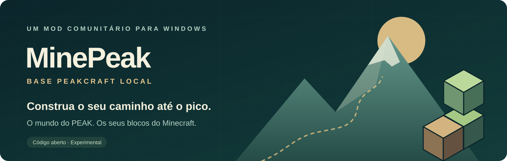
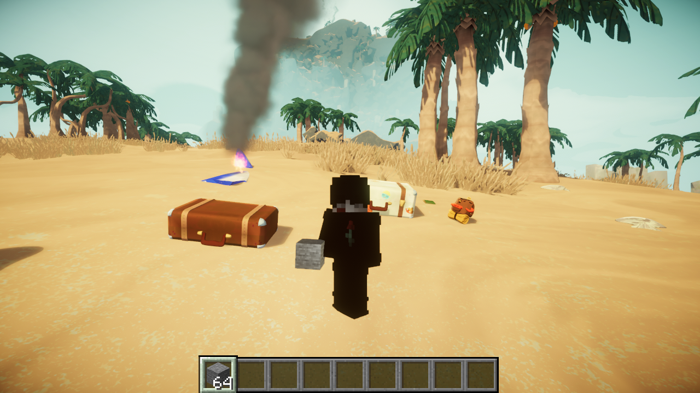

<div align="center">



**O mundo real do PEAK. Sua skin, seu inventário e seus blocos do Minecraft.**

*MinePeak, baseado em PeakCraft Local / PeakCraft Co-op.*

[](https://github.com/deadbynetsu/MinePeak/actions/workflows/tests.yml)

[Como jogar](COMO-JOGAR.md) · [Instalação](README-PT.md) · [Multiplayer](MULTIPLAYER.md) · [Testes desta versão](VALIDACAO-0.3.0.md) · [Créditos](referencia-coop/PROVENIENCIA.md)

</div>

MinePeak conecta **PEAK, aberto pela Steam**, a uma instância de **Minecraft Java** em segundo plano. Explore o aeroporto e a ilha originais, ative o modo Minecraft dentro da partida e construa caminhos com blocos. Volte aos controles do PEAK quando quiser, sem reiniciar os jogos.

Esta é uma adaptação comunitária gratuita e experimental do **PeakCraft Co-op**. Os jogos continuam sendo necessários e não estão incluídos. O projeto não é afiliado a Mojang, Microsoft, Landfall ou Aggro Crab.



*Captura real da integração, registrada na validação local. Não é uma imagem de conceito.*

## Construa, explore, alterne

- **Blocos no PEAK:** coloque e quebre blocos Minecraft no cenário original. A montanha do PEAK permanece intacta.
- **Modo opcional:** ative pelo botão no menu Esc ou por F8. A escolha fica salva.
- **Sua identidade:** nome e skin 64×64 do perfil local do SKLauncher, quando disponíveis, com opção de imagem própria.
- **Fome e vida compartilhadas:** alimentação, dano e cura atravessam a ponte entre os jogos. A stamina de escalada continua sendo do PEAK.
- **Equipamento nativo:** segure B para usar os itens do PEAK; escolha com 1–4, use com o mouse e segure/solte Q para arremessar. Comida, bandagens e lançamento de cerca de 23 metros foram conferidos no jogo. Solte B para retornar ao Minecraft.
- **Escalada nativa:** segure V perto de uma parede e use WASD. A escalada e o consumo de stamina são executados pelo PEAK; solte V para voltar aos blocos.
- **Base cooperativa:** compartilhamento de blocos, skins e poses pelo lobby do próprio PEAK. Cada PC executa sua própria ponte local.

Durante B ou V, o corpo e os controles usados são temporariamente os nativos do PEAK. A aparência Minecraft retorna ao terminar. Consumo de marshmallow, carga de arremesso e escalada com gasto de stamina foram exercitados no jogo real. A colisão recebeu exportação dos colliders do cenário, incluindo malhas disponíveis somente na GPU. O [relatório 0.3.0](VALIDACAO-0.3.0.md) identifica os cenários e seus limites.

## Comece a jogar

Requisitos desta versão: **Windows 11 de 64 bits**, PEAK instalado pela Steam e acesso aos arquivos necessários do Minecraft Java. A combinação exercitada localmente foi **PEAK 3.0.1 + Minecraft Java 26.3**. A preparação instala Java 25 e BepInEx em pastas locais do projeto.

1. Baixe o projeto e extraia para uma pasta própria.
2. Leia a [EULA do Minecraft](https://www.minecraft.net/eula). Se concordar, abra PowerShell nessa pasta e prepare a instalação:

   ```powershell
   powershell.exe -NoProfile -ExecutionPolicy Bypass -File .\Preparar.ps1 -AceitarEula
   ```

   Para uma instalação PEAK não detectada automaticamente, acrescente `-PeakDir 'D:\caminho\PEAK'`.

3. Deixe a Steam aberta e execute **JOGAR.cmd**. Aguarde o Minecraft oculto e o PEAK carregarem.
4. Entre em uma partida e ative **modo Minecraft** pelo menu Esc ou por **F8**.

A primeira abertura pode demorar para baixar bibliotecas oficiais. O guia **[Como jogar](COMO-JOGAR.md)** mostra os controles, o primeiro bloco, alimentação e solução de problemas.

O lançador pode ler a identidade pública e uma skin já armazenada pelo SKLauncher. Ele não usa senhas ou tokens do launcher. A sessão local não autentica em Realms ou servidores Microsoft; a Steam mantém seu fluxo normal de autenticação e convites.

## Controles principais

| Ação | Controle |
| --- | --- |
| Ativar/desativar modo Minecraft | F8 ou Esc → painel PeakCraft Co-op |
| Andar / pular / correr / agachar no Minecraft | WASD / Espaço / Ctrl / Shift |
| Colocar / quebrar bloco colocado | Botão direito / esquerdo |
| Inventário / terceira pessoa | E / F5 |
| Interagir com o mundo do PEAK | G; segure nas interações que exigem tempo |
| Usar equipamentos do PEAK | Segure B; 1–4 selecionam, mouse usa |
| Arremessar item PEAK | Com B segurado, segure Q e solte |
| Escalar com a física e stamina do PEAK | Segure V perto da parede; WASD move, Espaço solta |
| Menu PEAK / menu Minecraft | Esc / O |

No modo nativo, os comandos normais do PEAK continuam valendo. **Blocos Minecraft são apoios físicos apenas no modo Minecraft**; no modo nativo eles permanecem visíveis, mas não ganham colisores PEAK.

## Cooperativo e estado dos testes

Use os lobbies, convites Steam ou códigos de sala do próprio PEAK. Todos os participantes devem instalar a mesma versão do projeto e ter suas próprias instalações e sessões dos jogos. Não é preciso abrir um servidor Minecraft separado. O **[guia multiplayer](MULTIPLAYER.md)** explica a preparação de cada PC e a sincronização desta versão.

**Ainda não há certificação de uma partida completa entre dois PCs/contas.** Testes puros, mensagens de rede e loopback local ajudam a verificar a implementação, mas não provam latência real, entrada tardia ou campanha cooperativa completa. Veja os relatórios antes de planejar uma sessão longa.

| Área | Evidência disponível |
| --- | --- |
| PEAK e Minecraft reais conectados | Aeroporto, embarque, praia, alternância de modos e construção locais |
| Fome e vida | 12 testes puros e cenários reais nos dois jogos em [VALIDACAO-FOME-VIDA.md](VALIDACAO-FOME-VIDA.md) |
| Equipamentos e escalada | Marshmallow PEAK consumido com comida sincronizada, carga de arremesso e subida real com gasto de stamina |
| Colisão | 6 testes de regiões, leitura de malhas GPU e teste em jogo de parede fina artificial; não cobre todo o mapa |
| Compartilhamento Co-op | 19 testes de protocolo/histórico de blocos, implementação Photon e loopback local; dois PCs ainda pendentes |
| Campanha completa e cume | Não percorridos integralmente nesta entrega |

As capturas e registros em **[PROVAS/](PROVAS/)** documentam o que foi executado. **[VALIDACAO-0.3.0.md](VALIDACAO-0.3.0.md)** registra esta revisão; **[VALIDACAO.md](VALIDACAO.md)** preserva os cenários anteriores e distingue o Co-op dos testes históricos da base clássica. Não se declara compatibilidade perfeita com todas as colisões, alimentos, mods ou versões futuras dos jogos.

Para repetir os **37 casos automatizados** sem abrir os jogos, instale o SDK .NET 10 e execute `./Testar.ps1`. A CI pública executa os mesmos projetos em Windows e Linux; o build completo do plugin usa os assemblies da instalação local do PEAK.

## Fontes e contribuições

| Pasta | Conteúdo |
| --- | --- |
| `coop/` | Plugin PEAK Co-op reconstruído do pacote MIT e adaptado; C# compilável |
| `coop-fabric/` | Extensão Java compilável de identidade, skin e fome/vida |
| `tests/` | Testes independentes dos jogos |
| `referencia-coop/` | Licenças, avisos e procedência do pacote de referência |
| `referencia-coop/fabric-reconstruido/` | Java reconstruído para auditoria; não é um projeto compilável |
| `peak/`, `fabric/`, `protocol/` | Fontes preservadas da base clássica |
| `binarios/` | Mods compilados; os jogos e seus assemblies não estão incluídos |

Compilação e configuração estão em **[README-PT.md](README-PT.md)**. Para contribuir, consulte **[CONTRIBUTING.md](CONTRIBUTING.md)**. Relatórios de bugs devem incluir versões, modo usado, passos e um trecho de log sem dados privados.

## Créditos e licença

MinePeak adapta o projeto local **PeakCraft Local**, derivado de **[PeakCraft Co-op, de Issac](https://melty.gg/m/peakcraft-co-op)**, remix do PeakCraft de **aeironnsarmiento**, baseado em **[SkyCraft, de chasmlol](https://github.com/chasmlol/SkyCraft)**. A arquitetura de dois jogos, a ponte e grande parte da implementação vêm desses projetos. Não é uma criação do zero.

A licença **[MIT](LICENSE)** e os avisos do pacote Co-op estão preservados. O C# Co-op foi reconstruído com ILSpy porque a ficha do remix não apontava um repositório de fontes. A [procedência](referencia-coop/PROVENIENCIA.md) detalha essa distinção. O [README upstream](README-UPSTREAM.md) registra a documentação anterior, incluindo suas limitações históricas; as instruções atuais são as desta página e do guia em português.

PEAK, Minecraft e suas marcas, executáveis e recursos pertencem aos respectivos titulares. Nenhum jogo, conta ou recurso proprietário é redistribuído; a integração não remove o DRM da Steam.
