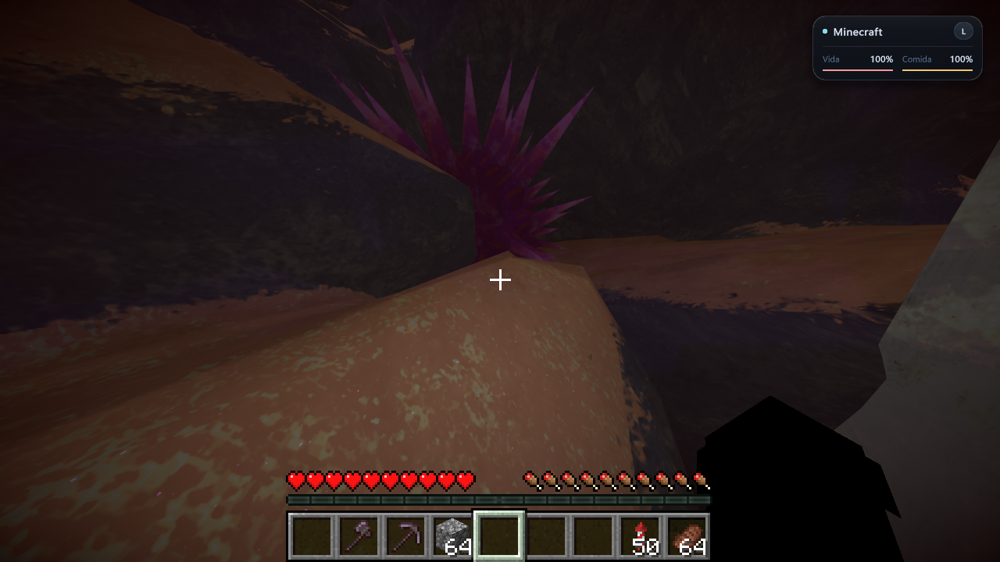
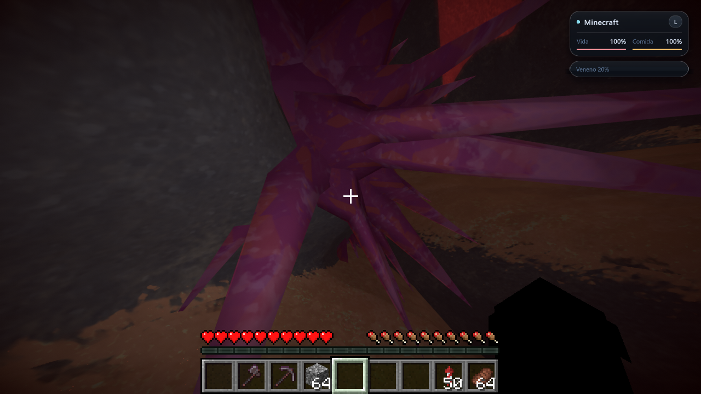
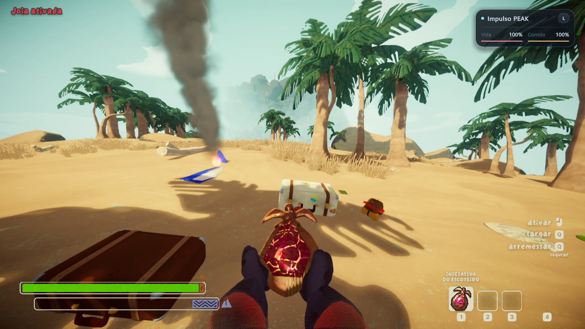

# MinePeak 0.4.1 — colisão, escalada e interação

Revisão local de **31 de outubro de 2026**, no **Windows 11**, com o **PEAK da instalação Steam local** — tela inicial **v2.0.1** nesta rodada — e uma instância real de **Minecraft Java 26.3**, usando a DLL **0.4.1** e a extensão Java do perfil **0.1.3**. Os bugs dos vídeos foram reproduzidos e comparados com o movimento nativo do PEAK. Os resultados abaixo descrevem os cenários exercitados; esta versão continua experimental.

## Correções e resultados no jogo

| Área | Reprodução anterior | Resultado observado após a correção |
| --- | --- | --- |
| Pedra inclinada da ilha | Na cena `Level_85`, sair da escada Minecraft próxima de `(-3.5, -462, 56.5)` fazia atravessar a pedra e cair cerca de oito metros. O PEAK nativo permanecia sobre a superfície no mesmo trecho. | O movimento controlado permaneceu do lado externo da pedra, com deslizamento pela superfície, vida em 100% e pés aproximadamente 0,23 m acima do apoio encontrado pela física nativa. Esse resultado cobre o trecho repetido, não todos os mapas. |
| Chegada à borda por V | O fim da marca de escalada devolvia o controle antes do movimento final de apoio, provocando queda. | A ponte espera o pouso nativo se firmar. Na parede construída, a versão anterior voltou à base em Y ≈ 20; a corrigida terminou apoiada no topo em Y ≈ 26. Na rocha da ilha, a subida foi de Y ≈ 47,997 a 50,027 e terminou após o registro de apoio estável. |
| Mão ao cruzar uma direção da câmera | O ângulo passava de +180° a −180°; a suavização da mão interpretava a diferença como uma rotação muito grande. | Rotação contínua em ambas as direções. Doze quadros da passagem 179° ↔ 181° mantiveram a posição da mão dentro de cerca de um pixel no recorte comparado; uma sequência com várias voltas chegou ao ângulo contínuo de 901°. O balanço normal foi preservado. |
| Menu radial da mochila | Abrir a roda mudava o controle para o menu PEAK, e G deixava de sustentar a interação. | A roda permaneceu aberta durante a interação mantida por G. A opção de vestir foi selecionada com o mouse e confirmada ao soltar a interação. A mochila real saiu do chão e apareceu no quarto espaço do jogador (`Backpack`); o controle retornou ao Minecraft ao fechar a roda. |
| Espinhos reais no modo Minecraft | A imobilização física do corpo suprimia contatos com certos perigos estáticos. Além disso, o HUD Minecraft não mostrava os estados nativos. | Contatos originais do PEAK continuam sendo gerados. Nos espinhos roxos da ilha, o veneno passou de 0,1 para 0,2 no modo Minecraft e o painel mostrou **Veneno 20%**. |
| Inventário, L e opções | As proteções de entrada precisavam ser repetidas após as mudanças. | E abriu o inventário; L manteve a tela Minecraft sem alternar o modo. Esc fechou a tela. O botão do cartão na pausa PEAK abriu as opções Minecraft, sem alterar preferências durante o teste. |

A sequência da mão tem cobertura temporal limitada: as capturas confirmam a passagem descrita, mas não certificam todas as combinações de taxa de quadros, sensibilidade e câmera. Os testes automatizados também verificam a continuidade do ângulo e a preservação do balanço.

## Colisão da rocha: causa e conferência

A rocha original tinha colisão válida no PEAK e sua malha já chegava ao Minecraft. A falha estava na escolha do lado de saída de certas faces inclinadas: a referência horizontal era tomada em um vértice que podia estar muito acima ou abaixo do corpo. A correção calcula essa referência na altura do corpo, mantendo a resolução do lado externo.

Na comparação local do trecho, **todos os 679 triângulos nativos comparados** estavam entre **1.655 triângulos recebidos** pela ponte. O erro máximo dos vértices comparados foi de aproximadamente **0,045 mm**. Isso ajuda a distinguir a perda de geometria do erro de resolução; a verificação de movimento no jogo continua sendo necessária.

A consulta do terreno também passou a usar as mesmas camadas físicas válidas para o corpo nativo. Colisores do próprio personagem, itens dinâmicos e os blocos já tratados pela ponte são filtrados. Os testes públicos usam geometria sintética própria.

## Estados e impulsos nativos

Vida compartilhada corresponde aos **ferimentos/Injury**, e comida corresponde à fome. Veneno, frio e outros estados permanecem sob as regras do PEAK e podem incapacitar o personagem com os corações Minecraft ainda cheios. O indicador resume esses efeitos no modo Minecraft.

O teste de contato preservou a imunidade original do aeroporto: o PEAK recusa estados nessa área. Na ilha, um cenário controlado usando os componentes originais de perigo produziu contatos válidos, aumentou o veneno com o intervalo nativo e levou ao estado de incapacitação. A verificação nos espinhos reais também confirmou o aumento de veneno descrito acima.

A revisão inclui retenção dos saltos e superimpulsos que o próprio PEAK inicia, além das forças emitidas pelo componente nativo `CollisionModifier`, para evitar congelar o corpo durante o movimento ou ao terminar uma ação temporária. As forças, o consumo e os eventos continuam sendo os originais do jogo. Esse tratamento não é uma interceptação de todas as forças possíveis do PEAK ou de outros mods. O salto nativo comum e a ativação real de `Amulet_SuperJump` foram repetidos, soltando B durante o voo. Nos dois casos, o controle permaneceu nativo no ar e retornou ao Minecraft após o apoio se firmar. O contato com espinhos reais na versão final também acionou a retenção do empurrão nativo e concluiu o retorno após o pouso. O efeito azul do vídeo não foi classificado como um salto extra sem confirmar o item e a ação envolvidos.

### Empurrão dos espinhos no jogo real

O personagem em modo Minecraft caminhou até um espinho roxo real de `Level_85`. O `CollisionModifier` nativo aplicou veneno e seu empurrão: o controle passou de Minecraft para PEAK antes da força, com o corpo livre para mover. Após o primeiro contato, a ponte registrou o pouso estável e devolveu o controle ao Minecraft. Contatos reais adicionais acumularam veneno e chegaram à incapacitação nativa; a ponte então respeitou esse estado e transferiu o controle à sequência PEAK.

Os corações e a comida compartilhados permaneceram em 20/20 nesse cenário, porque o efeito aplicado era veneno nativo, não ferimentos ou fome. Isso confirma a distinção descrita acima: os outros estados PEAK continuam podendo incapacitar o personagem mesmo com esses dois valores cheios. O teste cobre esse perigo e os caminhos interceptados, sem certificar todos os emissores de força do jogo ou de outros mods.

### Salto e amuleto no jogo real

No salto comum, B foi solto enquanto o personagem ainda estava no ar: o PEAK manteve o controle, sem apoio no chão e com salto ativo, e só devolveu o corpo ao Minecraft após o registro de pouso estável.

Na praia de `Level_85`, o amuleto real **`Amulet_SuperJump`** foi selecionado e ativado pelo fluxo nativo. Cada ativação observada aplicou sete pontos de petrificação; duas ativações chegaram a 14. O efeito nativo de baixa gravidade durou três segundos. Ao soltar B no ar após a ativação, o corpo continuou sob a física PEAK: os pés estavam em Y ≈ 3,659, comparados à base em Y ≈ 1,994, sem apoio e há cerca de um segundo fora do chão. O retorno ao Minecraft ocorreu após o pouso estável, sem cancelar o efeito ao soltar a tecla.

Esse amuleto é uma ação ativa de impulso/baixa gravidade. O teste não o identifica como um passivo de salto duplo, nem demonstra que o efeito azul de cada vídeo vem desse mesmo item.

## Conferência final da entrega

| Verificação | Estado desta rodada |
| --- | --- |
| Colisão no trecho da pedra, borda por V, mão e espinhos reais | Resultados observados acima. |
| Menu da mochila, seleção e equipamento | Aprovados: roda sustentada, opção de vestir selecionada, mochila removida do chão e confirmada no quarto espaço nativo. Retorno ao Minecraft após fechar a roda. |
| Salto, amuleto e empurrão dos espinhos | Aprovados nos cenários reais descritos: física nativa preservada durante o voo/empurrão, retorno após pouso estável e incapacitação por veneno respeitada. |
| Compilação final dos mods | DLL aprovada: zero erros e quatro avisos já conhecidos da reconstrução. Extensão Java aprovada (`BUILD SUCCESSFUL`), sem o probe temporário de geometria. Os hashes dos binários testados constam abaixo. |
| Suíte final Windows | **196/196 aprovados**, processo encerrado com código zero. |
| CI Windows/Linux e ZIP público | Conferir o resultado do commit publicado nos workflows e na Release. |
| Limpeza dos cenários de teste e preservação dos dados | Jogos encerrados; 91 arquivos dos saves anteriores aos testes restaurados e comparados por SHA256. Perfil normal com diagnóstico e simulação de rede desligados; tecla L preservada. |

## Binários da revisão

Estes hashes SHA-256 identificam os arquivos compilados usados na rodada final local. A integridade do ZIP publicado deve ser conferida com o `.sha256` da Release; os arquivos internos também são verificados durante o empacotamento.

| Arquivo | SHA-256 |
| --- | --- |
| `binarios/PeakCraftCoop.dll` | `3fd3bce6c5c69e994f0f737b50822b05aba8a539640c9cd6930257536d004e1f` |
| `binarios/peakcraft-profile-0.1.3.jar` | `13a6d4e86f703ac81d6a7615f6eb7f7c120d465a83b7051e7b9d6eaf88194439` |

## Suíte automatizada

| Área | Resultado local Windows |
| --- | ---: |
| Fome e vida | 12/12 |
| Regiões e mensagens de colisão | 18/18 |
| Rede e histórico de blocos | 21/21 |
| Segurança de entrada | 12/12 |
| Identidade de cena e filtro de mensagens | 18/18 |
| Rotação contínua da câmera | 11/11 |
| Movimento e retorno nativos | 33/33 |
| Ciclo de imobilização e restauração de contatos | 7/7 |
| Ponte dos impulsos de perigos nativos | 8/8 |
| Instalador | 9/9 |
| Inicializador Windows | 9/9 |
| Diário de saves e verificação de backups Java | 24/24 |
| Faces inclinadas | 14/14 |
| **Total Windows** | **196/196** |

Os nove casos do inicializador são específicos do Windows; o roteiro portátil prevê **187 casos no Linux**. A aprovação local não antecipa o resultado da CI. Os registros ficam nos [testes desta revisão](PROVAS/bugfix-041-tests.log) e nos [workflows públicos](https://github.com/deadbynetsu/MinePeak/actions).

Para repetir a suíte, use **SDK .NET 10 e JDK 17+** e execute `./Testar.ps1`. O JDK 25 preparado pelo projeto atende ao requisito. O build completo do mod usa referências da instalação local do PEAK; esses assemblies não são distribuídos. Os testes com fronteiras simuladas verificam a lógica de controle e restauração, mas não substituem contatos Unity, apresentação visual ou uma partida em rede.

## Provas e histórico

- [Resultados resumidos](PROVAS/bugfix-041-results.json), [registros PEAK selecionados](PROVAS/bugfix-041-peak.log), [registros Minecraft selecionados](PROVAS/bugfix-041-minecraft.log) e [testes automatizados](PROVAS/bugfix-041-tests.log).
- [Checksums dos mods e das provas](PROVAS/checksums.json).
- Relatórios anteriores preservados: [0.4.0](VALIDACAO-0.4.0.md), [0.3.2](VALIDACAO-0.3.2.md), [0.3.1](VALIDACAO-0.3.1.md), [0.3.0](VALIDACAO-0.3.0.md) e [fome/vida](VALIDACAO-FOME-VIDA.md).

## Limites

**O teste de uma campanha inteira ainda está pendente:** falta percorrer a rota completa até o cume e o encerramento com a integração. O mundo e o conteúdo original são executados pelo próprio PEAK. Os testes de embarque, praia, escalada e retorno por diagnóstico não equivalem a concluir essa rota.

Também permanece pendente uma sessão completa entre **dois PCs e duas contas Steam reais**, incluindo latência e entrada tardia. Cada PC precisa da mesma versão e de sua ponte Java. Inventários, NBT, entidades e redstone não formam um servidor Minecraft compartilhado; veja [MULTIPLAYER.md](MULTIPLAYER.md).

A revisão não certifica todos os mapas, blocos, alimentos, equipamentos ou combinações de mods. A montanha nativa permanece não escavável. A falha de encerramento PEAK `0xC0000005`, reproduzida anteriormente também sem o mod, permanece sem causa determinada conforme o [relatório 0.4.0](VALIDACAO-0.4.0.md#encerramento-observado). Não há garantia de ausência de bugs.

No encerramento desta rodada também apareceu um aviso gerenciado de limpeza ("shutdown: Object reference not set to an instance of an object."). Sua origem não foi confirmada; ele é distinto da falha nativa histórica acima. O Minecraft salvou os jogadores e mundos e terminou normalmente. Esse aviso permanece como pendência de diagnóstico.
