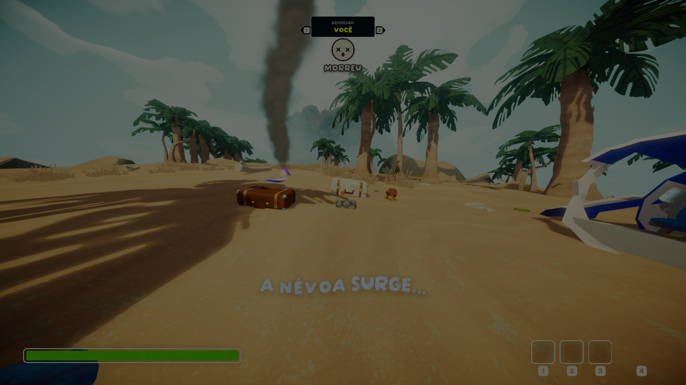
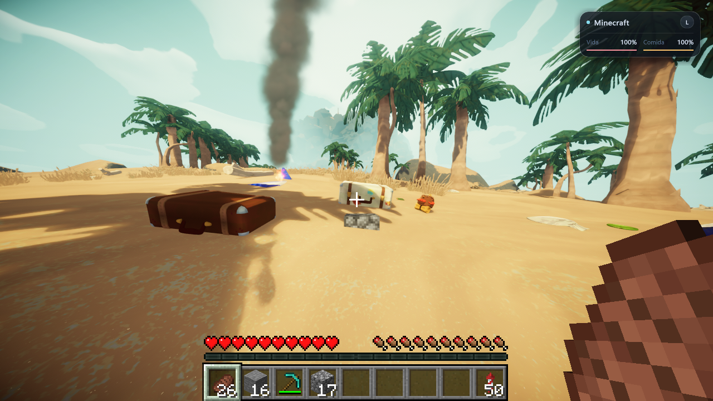

# MinePeak 0.4.2 — morte, desmaio e custo da apresentação

Revisão de **1º de novembro de 2026**, no Windows 11, com PEAK da Steam local e Minecraft Java 26.3. A DLL **0.4.2** compilou com zero erros e quatro avisos já existentes; os **265 testes automatizados Windows passaram**, com código de saída zero. Na compilação otimizada, os testes reais de morte, desmaio, recuperação, troca de modo e uso temporário de B passaram. Os jogos foram encerrados e os saves anteriores aos testes foram restaurados e comparados por SHA256. A entrega pública é conferida pela CI e pela verificação do ZIP publicado. Esta versão permanece experimental.

## Causa e comportamento corrigido

A seleção anterior usava um intervalo numérico de estados que incluía `Cutscene`. Morte, desmaio e outras sequências nativas acabavam autorizando o desenho do HUD, da mão e do avatar Minecraft, embora a câmera e a física já tivessem voltado ao PEAK.

A apresentação agora usa regras explícitas, separadas de quem controla a física:

- HUD, mão, seleção e modelos Minecraft aparecem somente quando a apresentação Minecraft está ativa.
- Morte, desmaio, carregamento e tela final bloqueiam essa apresentação, inclusive se o estado do personagem mudar antes da próxima atualização do controle.
- As construções Minecraft continuam visíveis na cena nativa, sem um avatar parado na posição antiga desenhado por cima.
- Com Minecraft selecionado e a ponte conectada, o corpo **local** do PEAK fica oculto durante a incapacitação. O filtro inclui o esqueleto, a estátua petrificada e seus fragmentos somente quando pertencem ao personagem local. A física, as colisões e os dados desses objetos permanecem nativos; os corpos dos outros jogadores não são afetados.
- Recuperação, troca para PEAK, perda da ponte e substituição do personagem restauram a visibilidade anterior. Com o personagem consciente, as ações de B e V continuam mostrando o corpo PEAK.

Essa correção **não implementa um cadáver Minecraft animado**. O corpo local fica invisível durante a incapacitação; a câmera, a morte, o desmaio e a reanimação seguem o PEAK. A apresentação dos outros jogadores não é substituída por esta correção. Após a recuperação, os objetos de cadáver retomam sua visibilidade original: um esqueleto deixado pelo PEAK pode continuar visível no cenário. Esses objetos continuam pertencendo ao jogo nativo.

## Otimização desta revisão

O tratamento da morte deixou de procurar esqueletos e estátuas na cena a cada quadro. Os eventos nativos de criação registram os renderizadores do corpo local em um cache; as trocas de modo reaproveitam esse registro. A aplicação da visibilidade ocorre em `LateUpdate`, sem repetir a consulta da hierarquia nem escrever novamente uma propriedade que já tem o valor desejado.

O HUD capturado também é invalidado sem destruir sua textura quando o PEAK assume temporariamente. A memória pode ser reaproveitada ao retornar, mas o quadro antigo não fica autorizado a desenhar: é necessária uma nova captura válida. Mudança de resolução, perda da ponte e encerramento continuam liberando os recursos quando necessário.

| Verificação automatizada | Resultado |
| --- | --- |
| Sessenta quadros estáveis de ocultação | Sem novas consultas da hierarquia ou escritas redundantes de visibilidade. |
| Registro de corpos derivados | Filtro pelo personagem local, reaproveitamento do cache e inclusão de fragmentos externos, com restauração exata dos estados anteriores. |
| Vinte idas e voltas ao controle nativo | Uma única textura de tela para 21 capturas válidas; nenhum quadro antigo redesenhado durante a invalidação. |
| Mudança de resolução e limpeza | Textura anterior liberada uma vez; limpeza idempotente de textura e cursor. |
| Captura inválida ou falha no envio à GPU | O quadro anterior permanece bloqueado até uma nova captura válida. |

No aeroporto do jogo real, foram executados **20 ciclos do caminho de B**, acionados pelo diagnóstico local. O contador de texturas de tela permaneceu em **1 → 1**, enquanto as capturas enviadas avançaram de **2.601 para 2.757**. Ao terminar, o controle estava em Minecraft, com HUD e modelos autorizados, quadro válido e corpo PEAK local oculto pela apresentação normal. Não apareceram erros nesse trecho.

Os testes e os contadores acima medem consultas, escritas, alocações e validade de quadros. **Não há medição de ganho de FPS** nem promessa de uma taxa de quadros específica.

## Conferência no jogo real

| Cenário | Resultado na compilação otimizada |
| --- | --- |
| Desmaio com Minecraft ativo | Aprovado na ilha: controle nativo, HUD/modelos Minecraft e quadro em cache bloqueados, HUD PEAK ativo, 322 renderizadores locais com ocultação forçada e nenhum renderizador do personagem local visível. |
| Recuperação do desmaio | Recuperação automática nativa seguida de transferência de controle e retorno ao Minecraft, com HUD autorizado e quadro válido. |
| Morte com Minecraft ativo | Aprovada: 332 renderizadores ocultos, sendo 322 do personagem e 10 do esqueleto pertencente a ele. O quadro antigo do HUD foi invalidado; o contador de texturas permaneceu em uma alocação. A captura mostra a tela nativa “MORREU / VOCÊ”, sem HUD, mão ou esqueleto local sobrepostos. |
| Troca para PEAK enquanto morto | Os 321 renderizadores originalmente visíveis do personagem e os dez do esqueleto voltaram a ser exibidos. O registro do corpo permaneceu em um, sem repetir sua coleta. |
| Volta ao Minecraft enquanto morto | Personagem e esqueleto locais voltaram a ficar ocultos; HUD/modelos Minecraft continuaram bloqueados. O mesmo registro de dez renderizadores do esqueleto foi reaproveitado. |
| Reanimação após morte | Aprovada no roteiro de diagnóstico: reanimação nativa e fechamento da tela final da partida solo, seguidos da transferência de controle e retorno do HUD Minecraft. Isso não equivale a uma reanimação cooperativa entre dois PCs. |
| Ação consciente de B | Aprovada: corpo PEAK visível com 321 renderizadores, sem ocultação forçada e sem HUD/modelos Minecraft. Ao soltar B, a apresentação Minecraft retornou. |
| Ação consciente de V | A política compartilhada de controle nativo é coberta pelos testes automatizados. Uma nova escalada real por V não foi executada nesta rodada; a verificação anterior está no relatório 0.4.1. |
| Blocos durante a morte | Bloco de pedra visível na captura da morte; uma seção com quatro caixas exatas de colisão continuou registrada. |
| Petrificação e fragmentos | Filtros e registro compilados e cobertos pelos testes dos eventos nativos; uma petrificação real não foi provocada nesta rodada. |
| Reutilização da textura no jogo real | Aprovada no aeroporto: 20 ciclos de B pelo diagnóstico, contador de texturas 1 → 1 e capturas 2.601 → 2.757. |
| Compilação e suíte Windows | Aprovadas: zero erros, quatro avisos já existentes e 265/265 testes, código de saída zero. |
| Restauração dos saves e perfil normal | Jogos encerrados e Minecraft salvo normalmente. Os 91 arquivos do backup mais recente anterior aos testes, de 1º de novembro, foram restaurados e todos os SHA256 conferiram. Perfil normal em PEAK, tecla L, diagnóstico e simulação de rede desligados. |
| CI e ZIP público | Consultar os workflows do commit publicado e a Release; resultados locais não antecipam sua aprovação. |

## Suíte automatizada e binários

A suíte executou os **196 casos anteriores** e **69 novos casos** desta revisão:

| Área nova | Casos aprovados |
| --- | ---: |
| Política de apresentação, renderizadores e cache de corpos | 48 |
| Registro dos corpos pelos eventos nativos | 9 |
| Recursos do overlay e bloqueio de quadros antigos | 12 |
| **Total novo** | **69** |
| **Total Windows** | **265** |

Os testes vinculam o código de produção a fronteiras controladas. Eles verificam as decisões, a restauração dos renderizadores, os registros de corpos e as chamadas de textura; não substituem câmera, telas e contatos Unity no jogo real.

O roteiro portátil prevê **256 casos Linux**, pois nove casos do inicializador são específicos do Windows. A CI deve ser conferida no commit publicado.

| Arquivo | SHA256 da compilação final |
| --- | --- |
| `binarios/PeakCraftCoop.dll` | `0741678b824c496cb25c90c762fa2d40f1a98fada7527961d3ad1d700047716c` |
| `binarios/peakcraft-profile-0.1.3.jar` | `13a6d4e86f703ac81d6a7615f6eb7f7c120d465a83b7051e7b9d6eaf88194439` |

A extensão Java **0.1.3** é a mesma da revisão anterior. Esta correção não altera seu protocolo nem seus arquivos. Use os mods do mesmo pacote de Release.

## Provas

- [Resultados resumidos](PROVAS/death-042-results.json).
- [Testes automatizados desta revisão](PROVAS/death-042-tests.log).
- [Registros próprios selecionados do PEAK](PROVAS/death-042-peak.log).
- [Checksums dos mods e das provas](PROVAS/checksums.json).
- [Workflows públicos](https://github.com/deadbynetsu/MinePeak/actions) e [Release 0.4.2](https://github.com/deadbynetsu/MinePeak/releases/tag/v0.4.2).

Os registros públicos contêm somente mensagens próprias selecionadas, sem contas, autenticação, mundos do usuário, caminhos privados ou código e geometria proprietários.

## Limites preservados

O [relatório 0.4.1](VALIDACAO-0.4.1.md) preserva os resultados de colisão da pedra, borda por V, mão, mochila, amuleto e espinhos. Sua aprovação não significava ausência de bugs; o relato de morte demonstrou uma condição que não estava coberta.

O teste da rota completa até o cume e o encerramento continua pendente. Isso é uma pendência de teste: o conteúdo original é executado pelo próprio PEAK. Também falta uma sessão completa entre dois PCs e duas contas Steam reais, incluindo latência e entrada tardia. A ocultação local do próprio corpo não certifica o comportamento de todos os clientes remotos.

Permanecem registrados no [relatório anterior](VALIDACAO-0.4.1.md#limites) o aviso gerenciado de limpeza ao encerrar e a falha nativa histórica `0xC0000005`, também reproduzida sem o mod. São ocorrências distintas, com origem ainda não determinada. Esta revisão de apresentação não declara corrigi-las.
