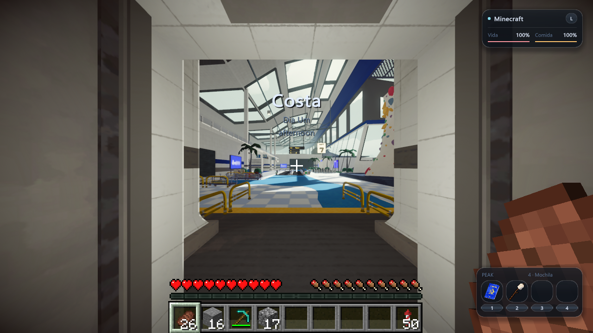

# MinePeak 0.4.3 — informações PEAK no modo Minecraft

O modo Minecraft passa a mostrar o anúncio de região, dia e horário do PEAK, acompanhando os textos, a animação e o desaparecimento originais. O anúncio usa texto com sombra, sem cobrir o cenário com o fundo do renderizador nativo.

No canto inferior direito, uma faixa discreta mostra os três espaços de itens e o quarto espaço de mochila do PEAK. Os ícones e suas cores vêm da interface do próprio jogo e acompanham suas atualizações. A faixa é somente visual: não possui botões, não recebe cliques e não equipa nem consome itens. As teclas numéricas continuam selecionando a barra Minecraft; para usar equipamentos PEAK, continue segurando **B**.

Esses elementos somem em inventários, menus, morte e desmaio, respeitando a correção da versão anterior. Durante B/V, a interface original PEAK continua sendo usada. A faixa fica fora do centro e acima da barra Minecraft.

O projeto continua experimental. Os limites de campanha completa, multiplayer entre dois PCs e encerramento descritos na [validação anterior](../../VALIDACAO-0.4.2.md) permanecem. Nenhum recurso dos jogos é incluído no pacote; os ícones são lidos da instalação local durante a partida.

## Conferência

Compilação aprovada e 265 testes de regressão aprovados no Windows. A inspeção no jogo conferiu a faixa de ícones atualizada após obter um item PEAK, o anúncio com região/dia/horário e a seleção da barra Minecraft por uma tecla numérica sem equipar item PEAK. O anúncio foi acionado pelo diagnóstico original do PEAK no aeroporto; a captura não representa uma entrada natural na Costa.

